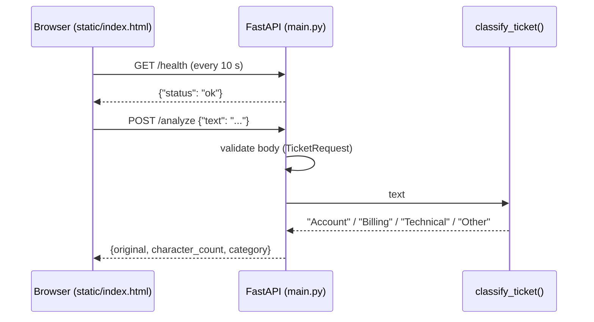

# Architecture

The whole backend is one file, `main.py`. It holds the FastAPI routes and one pure function, `classify_ticket()`, that does the actual work.

## How does a request flow?



1. **Validation.** FastAPI parses the JSON body into `TicketRequest`. If `text` is missing, empty, or not a string, it replies `422` before your code runs.
2. **Classification.** `analyze_ticket()` passes the text to `classify_ticket()`.
3. **Response.** The handler returns the original text, its length, and the category.

## Why is `classify_ticket()` separate from the route?

It's plain Python with no FastAPI in it, so it can be tested directly (`classify_ticket("refund") == "Billing"`) and reused elsewhere, for example in a CLI or a batch job.

## How classification works

The rules live in one constant at the top of `main.py`:

```python
CATEGORY_KEYWORDS = (
    ("Account", ("login", "log in", "password", "account")),
    ("Billing", ("invoice", "payment", "refund")),
    ("Technical", ("error", "bug", "crash", "dashboard")),
)
DEFAULT_CATEGORY = "Other"
```

`classify_ticket()`:

1. lowercases the text, so matching ignores case;
2. walks the categories **in order** and returns the first one where any keyword appears in the text;
3. returns `"Other"` if nothing matched.

Things to know:

- **Order is priority.** `"login error after payment"` is **Account**, since Account comes first.
- **Matching is by substring, not whole word.** `"crashing"` matches `crash` (useful), but `"debug"` also matches `bug` and `"accountant"` matches `account` (probably not intended).
- **Whitespace-only text is accepted.** `"   "` passes validation and comes back as `Other`.

### Adding a category

Add a row to `CATEGORY_KEYWORDS` at the position that matches its priority. Use lowercase keywords:

```python
("Shipping", ("delivery", "tracking", "shipment")),
```

Then add a test for it in `tests/test_main.py` (see [Testing](testing.md)).

## Static files

`GET /` serves `static/index.html`. The path is built from the location of `main.py` (`INDEX_HTML`), so the page loads no matter which directory you start the server from.

## What is `src/backend/`?

It's the package that `uv init` generated. It backs the `backend` console script declared in `pyproject.toml`, which currently only prints `Hello from backend!`. The web app does not use it.
